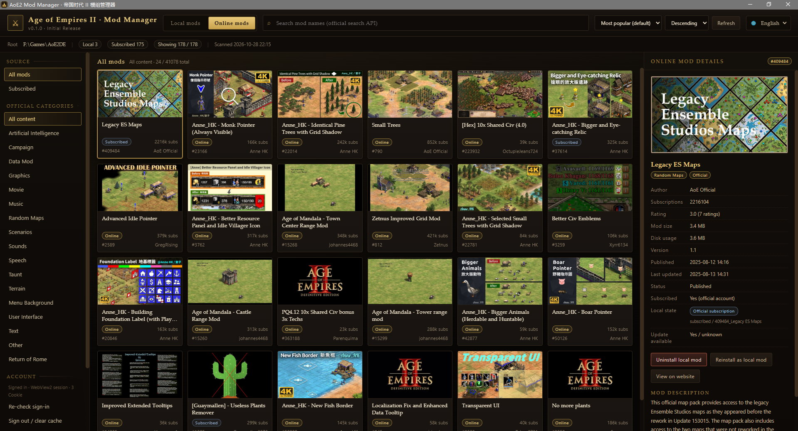
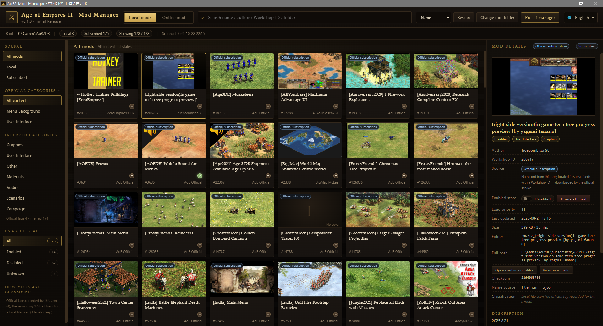

**English** | [中文](./README.zh.md)

# AoE2 Mod Manager

<table>
  <tr>
    <td align="center" width="50%">
      <a href="./docs/screenshot-online.png"></a>
      <br>
      <sub><b>Online Mod Browser</b></sub>
    </td>
    <td align="center" width="50%">
      <a href="./docs/screenshot-local.png"></a>
      <br>
      <sub><b>Local Mod Manager</b></sub>
    </td>
  </tr>
</table>

A desktop mod manager for **Age of Empires II: Definitive Edition**, built with Tauri 2 + Vue 3 + TypeScript + Rust.

It reads the real files the game writes (`local/`, `subscribed/`, `info.json`, `mod-status.json`), shows you what is actually on disk, and lets you enable/disable mods, save mod presets, and browse/install mods from the official Age of Empires mod service — without guesswork and without touching anything it does not fully understand.

---

## Features

### Local mods
- Scans `local/` and `subscribed/` and merges them into one list (name, author, Workshop ID, cover, size, file count).
- Shows the **enable state, load priority, last update and checksum exactly as `mod-status.json` records them** — never inferred.
- Toggle a mod on/off: the app first verifies the game is not running, backs up `mod-status.json`, changes only the `Enabled` field, then reads the file back and rolls back automatically if verification fails.
- Reveal any mod folder in Explorer, open its official page, or delete just that one local folder (with an explicit confirmation that explains the consequences).

### Presets & batch restore
- Save the current set of enabled mods as a named preset.
- After a game update disables everything, restore the whole set in one click.
- Every apply is backed up, verified, and reported item by item (restored / already enabled / no longer present).

### Online mods (official service)
- Search, browse and install mods from `api.ageofempires.com`, with the official categories, sort options and pagination.
- Sign-in happens in an embedded WebView2 window on the official Microsoft / Steam / PlayStation pages. **This app never asks for or stores your password.** The session cookie can optionally be cached locally with Windows DPAPI (remember-me).
- Installed mods are placed in `local/` so the game can enable them immediately.
- Network settings: follow the Windows system proxy automatically, or set a manual proxy (useful for players behind a proxy).

### First-run setup
- On first launch the app searches the Windows registry, your Steam libraries, the user profile and common install paths for an Age of Empires II: Definitive Edition folder.
- If nothing is found (or the saved path disappears later), a setup wizard lets you pick the mod root folder manually and validates it before use.

### Packaging
- **NSIS installer** with a language selector (English / Simplified Chinese), a per-user / all-users choice and a fully custom install directory.
- **Portable ZIP**: extract anywhere, no installation, no admin rights.

### Localization
- Ships with English and Simplified Chinese; the UI language can be switched in the top bar and is remembered in `settings.json`.
- Language packs are loaded automatically from `src/i18n/locales/*.ts`, so adding a new language is a single drop-in file (see [Adding a language](#adding-a-language)).

---

## Requirements

- Windows 10 / 11 (x64)
- Microsoft Edge **WebView2 Runtime** — preinstalled on Windows 10/11; otherwise install it from <https://go.microsoft.com/fwlink/p/?LinkId=2124703>
- Age of Empires II: Definitive Edition (Steam or Microsoft Store)

---

## Install

**Installer** — run `AoE2 Mod Manager_0.1.0_x64-setup.exe`, choose *all users* or *current user*, then pick any install folder (any drive works).

**Portable** — extract `AoE2ModManager-0.1.0-win-x64-portable.zip` anywhere and run `aoe2-mod-manager.exe`. Keep `WebView2Loader.dll` next to the executable.

Settings, presets and the optional login cache are stored in `%APPDATA%\com.aoe2.modmanager` in both cases.

---

## Safety guarantees

- Nothing is written unless you explicitly ask for it (enable/disable, preset apply, install, delete), and every write is preceded by a backup.
- The game must be closed; a running `AoE2DE_s.exe` makes the app refuse the operation.
- Only the `Enabled` field of the target record is modified — `CheckSum`, `LastUpdate`, `Priority` and `Unsub` are preserved byte-for-byte in meaning, so checksums keep matching.
- Deleting a mod only removes that one local folder and its `mod-status.json` record. It never sends unsubscribe requests; use *View on website* for that.
- Unknown data is displayed as *not provided / unknown* with the reason, never as a plausible guess.

---

## Development

| Component | Notes |
| --- | --- |
| Node.js | 22.x (Vite 8 requires `^20.19 \|\| >=22.12`) |
| Rust | stable, `x86_64-pc-windows-gnu` toolchain used for the released binaries |
| MinGW-w64 | provides `dlltool` / `windres` / `gcc` |

```powershell
npm install
npm run tauri dev      # dev mode (Vite + desktop window)
npm run build          # frontend only (vue-tsc type check + vite build)
npm run tauri build    # NSIS installer
npm run portable       # portable ZIP in dist-portable\
```

Backend tests:

```powershell
cargo test --manifest-path src-tauri\Cargo.toml -- --nocapture
```

### Windows GNU toolchain note

MinGW's `gcc` specs link its own `default-manifest.o`, which conflicts with the manifest injected by `tauri-build` and silently disables Common-Controls v6 (the app then dies at startup with `0xC0000139`). Run the one-time patch on a fresh machine:

```powershell
powershell -NoProfile -ExecutionPolicy Bypass -File scripts\setup-toolchain.ps1
```

### Adding a language

1. Copy `src/i18n/locales/en.ts` to `src/i18n/locales/<code>.ts` (the file name **is** the language code, e.g. `de.ts`).
2. Set `export const label = "Deutsch";` and translate the strings. Missing keys fall back to English.
3. That's it — the language appears in the top-bar switcher automatically, and the system language is detected on first launch.

---

## Project structure

```
F:\AoE2ModManager
├─ src/                          frontend
│  ├─ App.vue                    three-column layout, top bar, filters, wizard host
│  ├─ components/
│  │  ├─ ModCard.vue             local mod card
│  │  ├─ ModDetail.vue           local mod detail panel
│  │  ├─ OnlineBrowser.vue       online tab (search / list / detail / install)
│  │  ├─ OnlineModCard.vue       online mod card
│  │  ├─ PresetManager.vue       preset modal
│  │  ├─ FirstRunWizard.vue      first-run mod-root wizard
│  │  └─ ConfirmDialog.vue       parchment confirmation dialog
│  ├─ i18n/
│  │  ├─ index.ts                auto-loading locale registry
│  │  └─ locales/{en,zh}.ts      language packs (one file per language)
│  ├─ online/                    official API client, types, tag localization
│  ├─ api.ts / types.ts / format.ts
│  └─ style.css                  dark parchment theme
├─ src-tauri/
│  ├─ src/scan.rs                mod scanning, info.json / mod-status.json parsing
│  ├─ src/settings.rs            settings, mod-root auto-detection (registry + Steam VDF)
│  ├─ src/presets.rs             presets and batch restore with backup / rollback
│  ├─ src/install.rs             download → extract → install → write mod-status.json
│  ├─ src/online/                official service client, session (WebView2 + DPAPI)
│  ├─ src/net.rs                 proxy resolution (manual / system registry / env)
│  ├─ src/metadata.rs            own mod metadata (official tags)
│  ├─ src/lib.rs                 Tauri commands
│  └─ build.rs                   manifest injection, WebView2Loader.dll staging
├─ scripts/                      icons, portable packaging, screenshot, toolchain patch
└─ docs/
```

---

## Data sources (no-fake-data policy)

| Field | Source |
| --- | --- |
| Title | `info.json` `Title`; otherwise the folder name without its numeric prefix (and that fact is shown) |
| Author / Description | `info.json` `Author` / `Description` (description shown as plain text) |
| Workshop ID | numeric prefix of the folder name, e.g. `108404_xxx` |
| Enable state / priority / last update / checksum | `mod-status.json` written by the game |
| Cover | a real `thumbnail.jpg` / `.png` / `.webp` inside the mod folder |
| Categories | official tags recorded when installing from the online tab, otherwise a local file scan (3 levels deep) |

Anything unavailable is shown as *not provided / unknown* together with the reason (missing `info.json`, no `mod-status.json` record, permission denied, …).

---

## Credits

Not affiliated with Microsoft, Xbox Game Studios or Forgotten Empires. Age of Empires is a trademark of its respective owners.
---

## ☕ Support the Development

If this tool has helped you, consider buying me a coffee! Your support keeps the project alive.

[](https://afdian.com/a/Einsteinband)